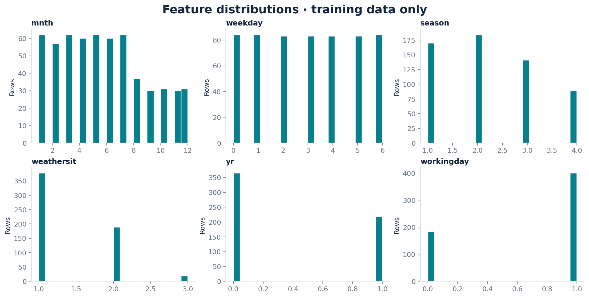
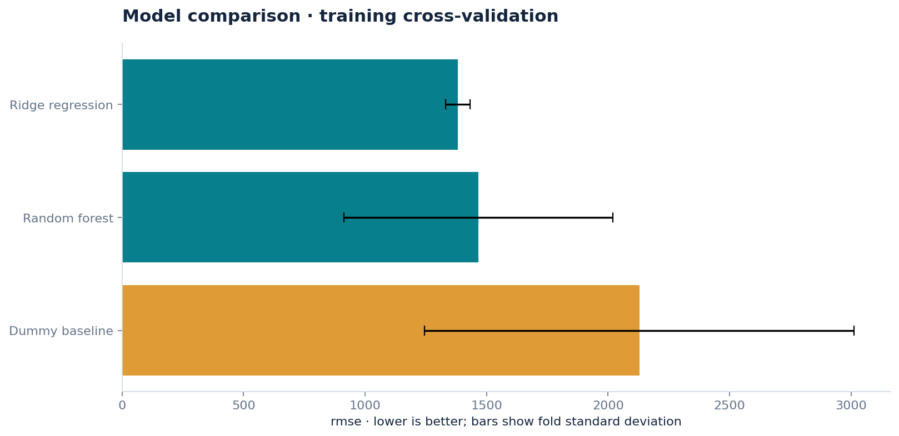
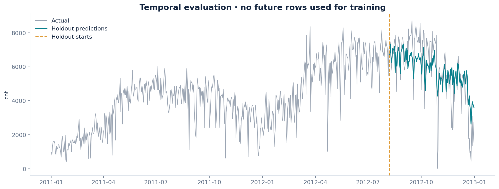
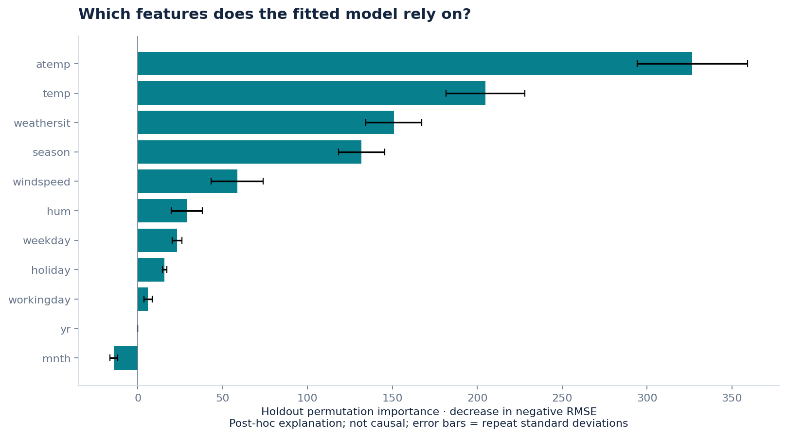

# تقدير الطلب اليومي على الدراجات

دراسة انحدار للطلب اليومي على تأجير الدراجات باستخدام المتغيرات التقويمية والطقس المرصود، على 731 يومًا من بيانات UCI.

جرى التقييم زمنيًا: 584 سجلًا للتدريب و147 سجلًا لاحقًا للاختبار، مع تحقق متقاطع بنافذة تدريب متسعة وفاصل سبعة صفوف. استُبعدت المتغيرات المكوّنة مباشرةً للهدف لمنع التسرب.

تفوق انحدار ريدج على خط الأساس في الاختبار. كانت الحرارة المحسوسة من أكثر المدخلات تأثيرًا في تبديل الخصائص، وبلغ ارتباط الحرارة والحرارة المحسوسة 0.997.

هذه تقديرات مشروطة بطقس مرصود، وليست توقعات مستقبلية تملك معلومات الطقس مسبقًا. تُعرض الدرجات بدقة النسخة الأصلية في الجداول.

## النتائج المسجّلة

الأرقام التالية من التنفيذ المحفوظ لهذه النسخة؛ لم تُعَد التجارب أثناء تعريب التوثيق.

### الاختبار الزمني المحفوظ

| النموذج | المقياس | القيمة |
| :--- | :--- | :--- |
| **انحدار ريدج** | **RMSE** | **1165.65** |
| انحدار ريدج | MAE | 870.67 |
| انحدار ريدج | $R^2$ | 0.6134 |
| خط الأساس البسيط | RMSE | 2560.56 |
| خط الأساس البسيط | MAE | 2290.41 |
| خط الأساس البسيط | $R^2$ | -0.8657 |

## الرسوم والنتائج المرئية

الرسوم محفوظة من التنفيذ الأصلي. تعريب هذه الصفحة لا يغيّر بياناتها أو تسميات الصور داخل الملفات.

## الملفات المرجعية

- [مقاييس التقييم والنتائج](metrics.json).
- [بيانات التدقيق وبيئة التنفيذ](audit.json).
- [مصدر البيانات وشروط الترخيص](SOURCE.md).
- [سجل أخطاء الاختبار](error_analysis.csv).
- [دفتر شرح التحليل](analysis.ipynb).
- [ملاحظات المراجعة البشرية](LEARNING_NOTES.md).

## المصادر والإسناد

- [مصدر 1: UCI Bike Sharing Dataset](https://archive.ics.uci.edu/dataset/275/bike+sharing+dataset).

[المرجع التقني الإنجليزي الكامل](README.en.md) يحفظ تفاصيل النسخة الأصلية. تُترك أسماء الملفات والأوامر ومعرّفات النماذج والمقاييس بصيغتها التقنية لضمان تطابقها مع الكود.
